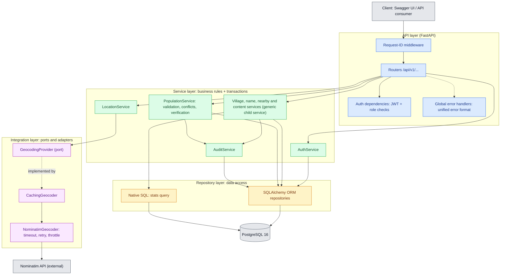
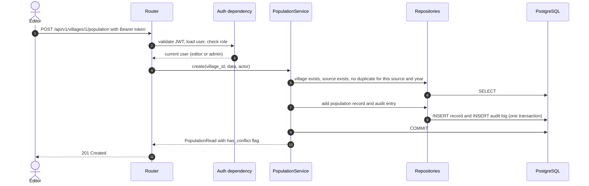
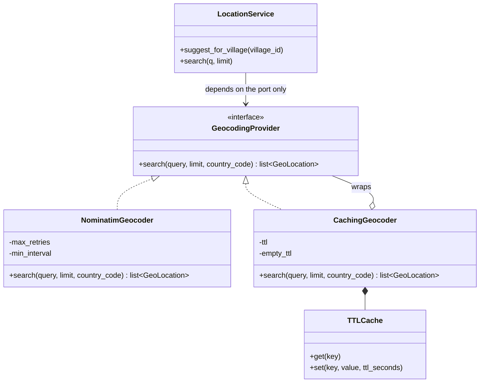
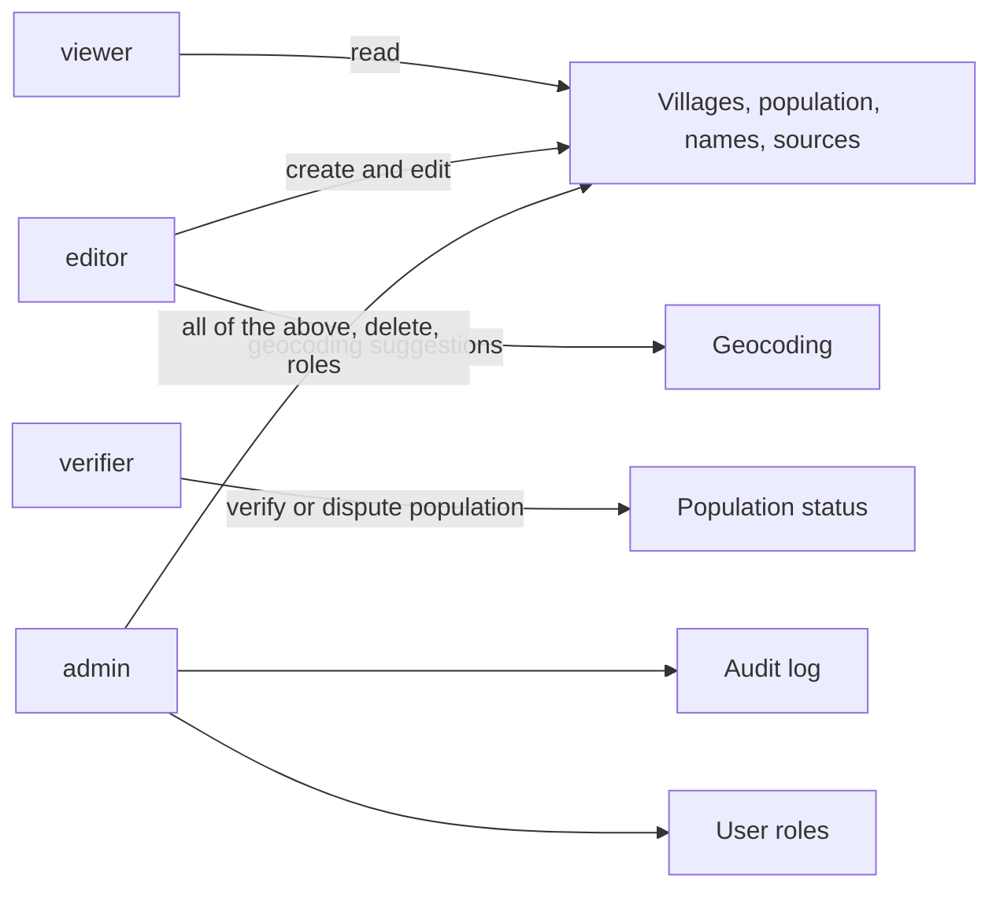

# Architecture

**Style:** layered modular monolith (FastAPI). One deployable unit, clear layers, dependencies
point one way: `API -> Services -> Repositories -> Models`. External systems sit behind a *port*
(interface), so they can be replaced without touching business code. Rationale: ADR-001.

## 1. Components and dependency direction

| Layer | Responsibility | Must **not** |
|---|---|---|
| API (`app/api`) | HTTP, request/response validation, authentication, role checks | contain business rules or queries |
| Services (`app/services`) | Business rules, transaction boundary, audit, mapping external errors | know about HTTP or SQL details |
| Repositories (`app/repositories`) | Queries (ORM + one native SQL case), eager loading, pagination | decide business rules |
| Integrations (`app/integrations`) | Talk to external providers behind a port | leak provider details upward |
| Models / schemas | Tables (ORM) / request-response DTOs (Pydantic) | depend on upper layers |

## 2. Request flow: adding a population record

If any rule fails, the service raises a typed error (`NotFoundError`, `ConflictError`, ...) and
nothing is committed; the global handler turns it into the unified JSON error with a `traceId`.

## 3. Replaceable external provider (UML class diagram)

Switching provider = one new class implementing `GeocodingProvider` and one line in `build_geocoder`
(see ADR-006).

## 4. Roles

