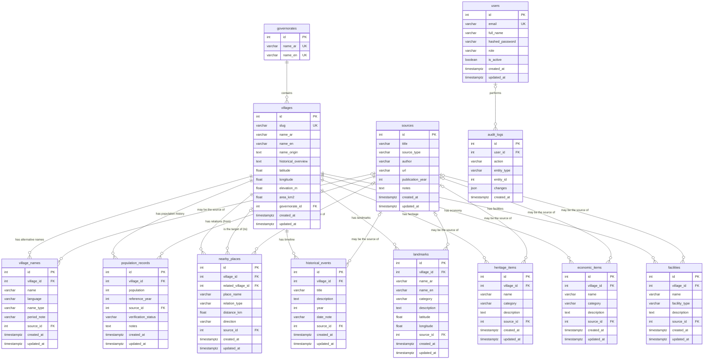

# Database schema (ERD)

PostgreSQL 16, managed with Alembic migrations (`alembic/versions/0001` ... `0006`).
Every fact that can be disputed (population, names, relations) can point to a row in `sources`.

`audit_logs.entity_type` + `entity_id` is a deliberate *generic* reference (no foreign key):
one table audits every entity, and the history survives when the audited row is deleted.

## Important modeling decisions

| Decision | Why |
|---|---|
| Population is a **history table**, not a column on `villages` | A village has many values over time from different references |
| `population_records.source_id` is `NOT NULL` with `ON DELETE RESTRICT` | Provenance is mandatory and a cited source can never disappear |
| `UNIQUE (village_id, reference_year, source_id)` | One value per source and year; *different* sources may disagree and both are kept (conflicts are flagged, never overwritten) |
| `verification_status` (`pending` / `verified` / `disputed`) | Review state is part of the data, so unreviewed numbers are never presented as verified |
| `village_names` is separate from `villages` | Many alternative / historical names per village, each with type, period and source |
| `UNIQUE (village_id, name, name_type)` on `village_names` | No duplicate names |
| `nearby_places` target is **either** a village **or** free text | `CHECK` enforces exactly one, so a city that is not modelled can still be recorded |
| Two *partial* unique indexes on `nearby_places` | A plain `UNIQUE` would not work because `NULL` values are distinct |
| Relations are directional, no automatic mirror | Avoids hidden writes that would complicate audit and consistency |
| `CHECK` constraints (population >= 0, year range, area > 0, elevation range, enums) | Integrity is enforced by the database, not only by application code |
| `ON DELETE CASCADE` for dependent rows (names, population, relations) | Deleting a village leaves no orphans; `audit_logs.user_id` uses `SET NULL` to keep history |
| Indexes on `villages(name_ar, name_en, governorate_id)`, `population_records(village_id, reference_year)`, `audit_logs(entity_type, entity_id)` | Support search, population history and audit lookups |
| Timeline entries need a year **and/or** a free-text period (`CHECK`) | Historical facts are often only known approximately ("late Ottoman period") |
| Content tables (events, landmarks, heritage, economy, facilities) share one shape: `village_id` (CASCADE) + optional `source_id` (SET NULL) | Same provenance and cleanup rules everywhere; implemented once in `VillageChildService` (ADR-008) |
| Categories / types are `CHECK`-constrained enums, `UNIQUE (village_id, name, category)` | Controlled vocabulary, no duplicates, same name allowed in different categories |
| Facilities are plain descriptive rows | Supporting context only: the platform is not a municipal service-management system |
